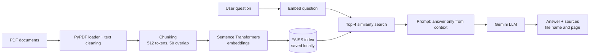

# Intelligent RAG-Based Chatbot using LangChain & LLMs

An AI Document Assistant that reads PDF documents and answers questions in natural language. Answers are generated only from the retrieved document text, and every answer shows its **source document and page number**.

## Problem Statement

Searching through long documents takes time and the exact information is hard to find. This project lets a user ask a question directly and get a grounded answer from the documents, using Retrieval-Augmented Generation (RAG).

## Technologies Used

| Part | Tool |
|---|---|
| Language | Python |
| Orchestration | LangChain |
| PDF reading | PyPDF |
| Embeddings | Sentence Transformers (`multi-qa-MiniLM-L6-cos-v1`) |
| Vector database | FAISS |
| LLM | Google Gemini (Google AI Studio API) |
| UI | Streamlit |
| Evaluation | RAGAS |

## Architecture



## Project Structure

```
RAG_CHATBOT/
├── rag_pipeline.py      # loading, cleaning, chunking, FAISS, retrieval, answer generation
├── build_index.py       # builds the FAISS index from data/documents
├── app.py               # Streamlit chatbot
├── requirements.txt
├── notebooks/RAG_Development.ipynb   # step-by-step development and RAGAS evaluation
├── data/documents/      # put the PDF files here
├── vectorstore/         # saved FAISS index (created by build_index.py)
└── evaluation/          # evaluation records and RAGAS scores (created by the notebook)
```

## Installation and Setup

1. Python 3.10 or newer is recommended. Create and activate a virtual environment, then install:
   ```
   pip install -r requirements.txt
   ```
2. Get a free API key from [Google AI Studio](https://aistudio.google.com/apikey).
3. Create a file named `.env` in the project folder:
   ```
   GOOGLE_API_KEY=your_key_here
   ```
   Optional: `GEMINI_MODEL=<model name>` to change the model (default `gemini-3.5-flash-lite`). Never share or commit this file.
4. Put your PDF files in `data/documents/`. (The notebook downloads the RAG paper from arXiv for the demo.)
5. Build the index (the first run downloads the embedding model):
   ```
   python build_index.py
   ```

## Run the Chatbot

```
streamlit run app.py
```

Ask a question in the chat box. Each answer has a **Sources** section. New PDFs can be added from the sidebar. If the answer is not in the documents, the bot replies: *"I couldn't find this information in the provided document."*

Handled cases: empty or very long questions, missing documents / missing index, and API errors (temporary errors are retried).

## Notes and Limitations

- Scanned (image-only) PDFs have no text layer. They are skipped, so run OCR (for example `ocrmypdf`) before adding them.
- The embedding model accepts 512 tokens, which matches the chunk size. Models with a shorter limit would cut chunks.
- Free-tier Gemini keys have rate limits; the evaluation notebook waits between calls.

## Sample Questions and Answers

Run the notebook (section 11.4) or the app and paste real outputs here. Suggested questions for the RAG paper:

- What is parametric memory in RAG?
- What is the difference between RAG-Sequence and RAG-Token?
- Which retriever does RAG use?
- Who won the FIFA World Cup in 2022? *(not in the document, should answer "I couldn't find this information")*

## Evaluation Results

13 question-answer pairs about the RAG paper are evaluated with RAGAS (faithfulness and answer relevancy) in section 12 of the notebook. Scores are saved to `evaluation/ragas_scores.csv`.

| Run | Chunk size / overlap | Top-K | Faithfulness | Answer relevancy |
|---|---|---|---|---|
| 1 | 512 / 50 | 4 | _fill from your run_ | _fill from your run_ |

Record the real numbers from your own run. Do not estimate them.
